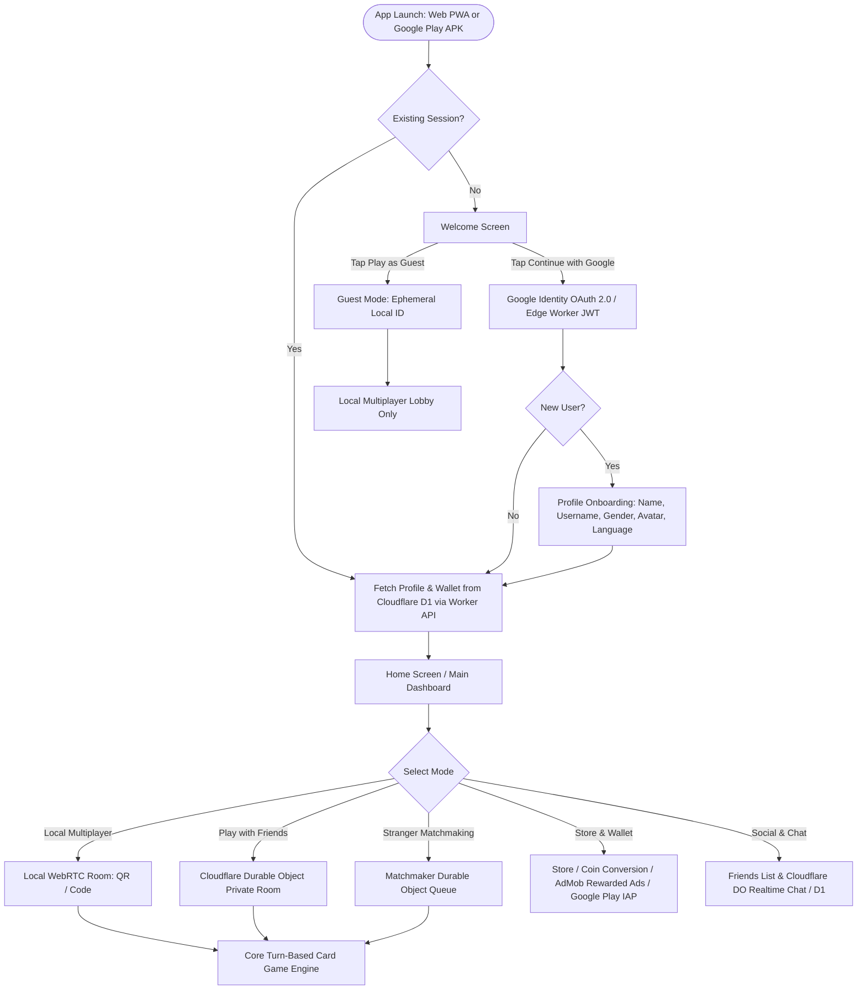
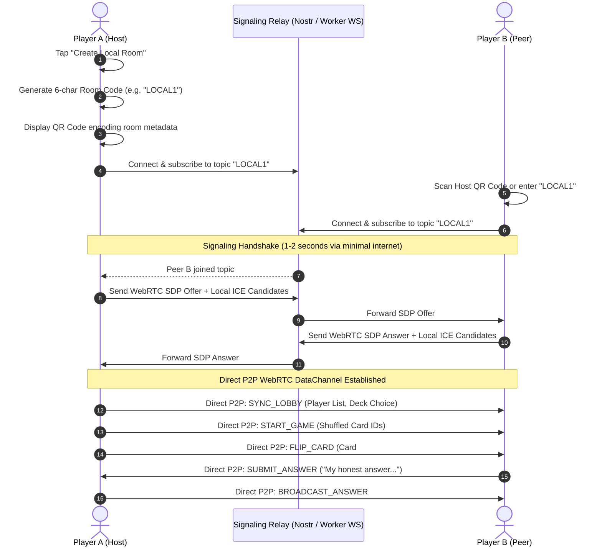
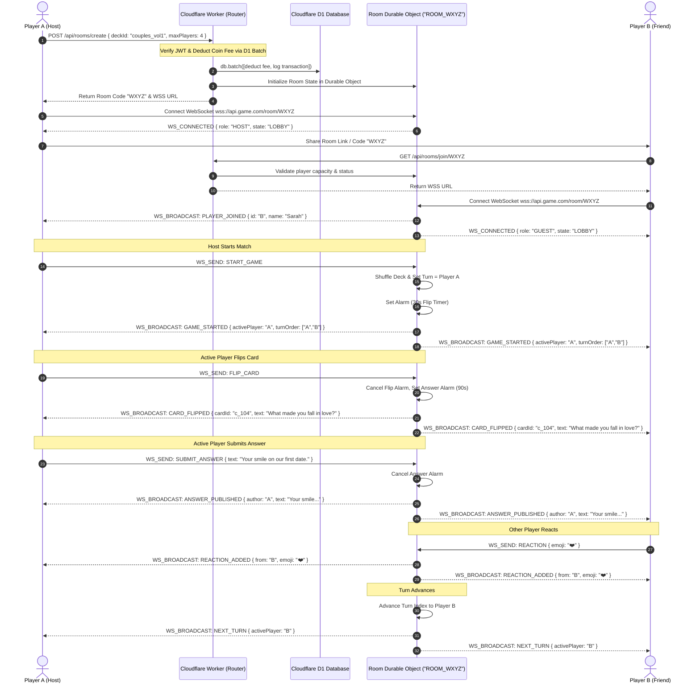
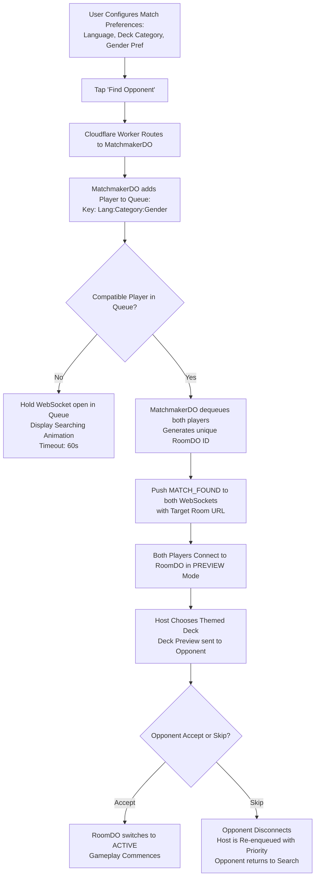

# GAME PRE-DEVELOPMENT BLUEPRINT
**Project:** Cross-Platform Turn-Based Conversation Card Game  
**Document Version:** 2.0.0 (Cloudflare D1 Native Architecture)  
**Target Platforms:** Android (Google Play Store via Capacitor) & Progressive Web App (Mobile/Desktop Web)  
**Architecture Classification:** Serverless Distributed Real-Time Architecture (Edge Compute + Cloudflare D1 Serverless SQL + P2P WebRTC)

---

## 1. Product Overview

### 1.1 Executive Summary & Game Concept
The product is a modern, social, turn-based conversation card game designed to spark meaningful, humorous, romantic, and deep conversations among friends, couples, and online strangers. Drawing inspiration from games like *We're Not Really Strangers*, *Rabble*, and *Sparks*, the game replaces physical card decks with an interactive, beautifully illustrated digital experience.

Instead of complex physics, twitch reflexes, or high-bandwidth 3D rendering, the core loop is centered around reading, reflecting, answering, and reacting. Players take turns flipping prompt cards from themed decks, submitting their answers, and engaging in lighthearted or intimate discussions through real-time text replies and emoji reactions.

```
       ┌────────────────────────────────────────────────────────┐
       │                   CORE GAMEPLAY LOOP                   │
       └───────────────────────────┬────────────────────────────┘
                                   │
                                   ▼
                        ┌─────────────────────┐
                        │  Turn Player Flips  │
                        │    Themed Card      │
                        └──────────┬──────────┘
                                   │
                                   ▼
                        ┌─────────────────────┐
                        │ Turn Player Submits │
                        │ Written / Spoken Ans│
                        └──────────┬──────────┘
                                   │
                                   ▼
                        ┌─────────────────────┐
                        │ Other Players React │
                        │  (Emojis / Replies) │
                        └──────────┬──────────┘
                                   │
                                   ▼
                        ┌─────────────────────┐
                        │ Turn Advances to    │
                        │    Next Player      │
                        └─────────────────────┘
```

### 1.2 Core Feature Matrix

| Feature | Description | Guest Availability | Registered User Availability |
| :--- | :--- | :--- | :--- |
| **Guest Authentication** | Instant single-tap anonymous session. Device-local storage with optional D1 shadow profile. | Read/Join only | Not applicable |
| **Google Authentication** | One-tap OAuth 2.0 via Google Identity Services, verified at edge by Cloudflare Workers. | No | Full access |
| **User Profile Management** | Nickname, unique @username, gender, avatar, bio, language, interests stored in Cloudflare D1. | Local session only | Cloud-synced across devices |
| **Deck Catalog & Categorization** | Themed card collections (Couples, Friends, Icebreakers, Deep Talks, After Dark) queried from D1. | Browse & Free Decks | Browse, Free, Standard & Premium |
| **Local Multiplayer (P2P)** | Offline/LAN rooms via WebRTC (Trystero) with QR code & 6-character room codes. | Join existing rooms only | Host and Join rooms |
| **Online Multiplayer (Friends)** | Cloudflare Workers + Durable Objects + WebSockets with direct invite links & codes. | No | Host and Join rooms |
| **Online Stranger Matchmaking** | Algorithmic pairing based on language, deck category, and gender preference via MatchmakerDO. | No | Full access |
| **Friends & Social Graph** | User search, friend requests, activity status (Online, In-Game, Offline), direct game invites in D1. | No | Full access |
| **Dual-Channel Messaging** | 1. Persistent 1-on-1 private messaging (Cloudflare D1 + DO Presence notifications).<br>2. Ephemeral in-game room chat & emoji reactions (DO memory). | No | Full access |
| **Dual-Currency Virtual Wallet** | **Coins** (soft currency earned via gameplay/ads) & **Diamonds** (hard currency via IAP/conversion) in D1 ACID ledger. | No | Cloud-verified transactional ledger |
| **Digital Store & Monetization** | Standard decks unlocked via Coins; Premium decks unlocked via Diamonds. | View prices only | Purchase, unlock, and own decks |
| **Ad-Based Rewarded Economy** | Rewarded video ads (claim coins, double-reward 2x multiplier), interstitial ads, daily streaks via AdMob SSV. | No | Full access |
| **Backoffice Admin Dashboard** | Web-based management console on Cloudflare Pages for decks, cards, translations, moderation, and analytics. | No | Role-Based Access Control (Admin only) |

---

### 1.3 User Journey & Architecture Connection



---

## 2. Technology Stack and Architecture Evaluation

### 2.1 Proposed vs Recommended Technology Stack

| Layer | Proposed Technology | Evaluation & Verdict | Recommended Architecture |
| :--- | :--- | :--- | :--- |
| **Frontend Framework** | React + TypeScript | **CONFIRMED**. Unrivaled ecosystem, robust typing for game state, seamless component reuse. | **React 18/19 + TypeScript + Vite + TailwindCSS + Zustand** |
| **App Delivery / Shell** | PWA (Progressive Web App) | **MODIFIED RECOMMENDATION**. A pure PWA cannot run native AdMob SDK or native Google Play Billing reliably. | **Dual-Target:** PWA for Web (`web`) + **Capacitor 6/7** for Android APK/AAB (`android`). Same React codebase. |
| **Authentication** | Google OAuth + Edge JWT | **CONFIRMED (EDGE-NATIVE)**. Google Identity Services verified directly on Cloudflare Workers with Web Crypto API (`jose`). Fast, serverless, zero external auth lock-in. | **Cloudflare Workers Edge Auth (Google OAuth 2.0 + EdDSA/HMAC JWTs + D1 User Profiles)** |
| **Primary Database** | Cloudflare D1 (Serverless SQLite) | **CONFIRMED PRIMARY DATABASE**. Cloudflare D1 provides distributed SQLite at the edge, native Worker bindings (`env.DB`), zero cold starts, zero network hops, and ACID transaction batches. | **Cloudflare D1 (Serverless Relational SQLite at the Global Edge)** |
| **Edge Compute / API** | Cloudflare Workers | **CONFIRMED**. Ultra-low latency (<50ms globally), zero cold-start, built-in V8 isolate security, WebSocket termination. Direct binding to D1. | **Cloudflare Workers (TypeScript / Hono framework)** |
| **Multiplayer State Engine** | Cloudflare Durable Objects | **CONFIRMED**. Provides distributed in-memory actor model with strong single-point-of-truth coordination per room. Direct binding to D1. | **Cloudflare Durable Objects with WebSocket Hibernation API** |
| **Realtime WebSockets** | Native WebSockets on DO | **CONFIRMED**. Durable Objects natively terminate WebSockets with hibernation (sleeping while connected, zero compute cost during idle). | **Standard WebSocket API (`wss://`) terminated on Durable Objects** |
| **Local Multiplayer** | Trystero + WebRTC | **CONFIRMED**. Peer-to-peer data channels eliminate server load; signaling via lightweight relay broker. | **Trystero (WebRTC DataChannels + Nostr/Worker signaling) + Local LAN** |
| **Object / Asset Storage** | Cloudflare R2 | **CONFIRMED**. S3-compatible, zero egress fees, edge caching via Cloudflare CDN for deck cover art and illustrations. | **Cloudflare R2 Bucket + Custom Domain CDN** |
| **Frontend Hosting** | Cloudflare Pages | **CONFIRMED**. Free edge static hosting with atomic deployments for Web PWA and Admin Portal. | **Cloudflare Pages (`game.example.com` & `admin.example.com`)** |

---

### 2.2 Deep-Dive Evaluation of Each Technology

#### 1. React + TypeScript + Vite
- **What it does:** Renders the user interface, manages client-side routing, and executes local game state transitions with strict compile-time type safety.
- **Why we need it:** Card game UI requires reactive rendering of card flips, countdown timers, optimistic chat updates, and modal dialogs. TypeScript guarantees that game events (`FLIP_CARD`, `SUBMIT_ANSWER`, `SEND_REACTION`) are strictly typed across client and server.
- **Communication:** Communicates with Cloudflare Workers via REST/JSON, with Durable Objects via WebSockets, and with peers via WebRTC Data Channels.
- **Pricing:** Open-source (MIT). Free.

#### 2. Capacitor (Android Wrapper for PWA)
- **What it does:** Wraps the compiled React/Vite web bundle into a native Android application (APK/AAB) that runs in Android System WebView while exposing native bridges.
- **Why we need it (The TWA Trap):** A pure Trusted Web Activity (TWA via Bubblewrap) runs inside Chrome Custom Tabs. In a TWA:
  1. *Native Google AdMob SDK cannot be embedded*. Google AdSense for Web strictly bans loading banner/rewarded web tags inside mobile app WebViews, leading to immediate account bans.
  2. *Google Play Billing* requires the experimental Digital Goods API, which has poor ecosystem support and maintenance overhead.
  Capacitor allows 100% of the UI to be written in React while calling native `@capacitor-community/admob` and native `@capacitor/in-app-purchases` seamlessly.
- **Pricing:** Open-source (MIT). Free.

#### 3. Cloudflare D1 (Serverless Relational SQLite)
- **What it does:** Acts as the persistent system of record. Stores user profiles, friendships, deck metadata, card texts, multilingual translations, wallet balances, purchase audit ledgers, and 1-on-1 private messaging history.
- **Why Cloudflare D1 is the Superior Choice:**
  1. *Native Colocation & Zero Latency:* D1 runs directly alongside Cloudflare Workers and Durable Objects across Cloudflare's global edge network. Database calls via `env.DB` incur zero TCP handshake overhead and zero public-internet routing latency.
  2. *Single Unified Backend:* Eliminates external database vendors and connection poolers (like PgBouncer). 100% of serverless compute, storage, real-time networking, and database live in the Cloudflare ecosystem.
  3. *Atomic Batch Transactions:* D1's `db.batch()` API executes multiple parameterized SQL statements inside a single atomic transaction. If any ledger credit or balance debit fails, the entire batch rolls back, guaranteeing ACID compliance for coins and diamonds.
  4. *Security Definer Model:* D1 has no public port or direct client connection string. It is accessible **exclusively** through Worker code bindings (`env.DB`), eliminating exposure to database scanning bots or external credential leaks.
- **Pricing (100% Free Tier):** Cloudflare D1 provides an extraordinary permanent free tier:
  - **Reads:** 5 Million row reads per day (~150 Million / month) for **$0.00**.
  - **Writes:** 100,000 row writes per day (~3 Million / month) for **$0.00**.
  - **Storage:** 5 GB database storage for **$0.00**.
  - More than enough capacity for thousands of active daily game sessions without spending a single dollar.

#### 4. Cloudflare Workers & Durable Objects
- **What it does:** 
  - *Workers:* Serverless edge compute running on 300+ edge locations worldwide. Handles REST routing, verifies Google OAuth tokens and edge JWTs, processes AdMob SSV callbacks, and validates Google Play IAP receipts.
  - *Durable Objects (DO):* Strongly consistent, stateful micro-servers using the **SQLite storage backend**. A single DO instance is created per Game Room (`RoomDO`), per Matchmaking Queue (`MatchmakerDO`), and for real-time user presence (`UserPresenceDO`). Holds active card decks in memory, acts as the referee for turn timers, and broadcasts state changes to players.
- **Why we need it:** Standard serverless functions are stateless—they cannot keep active WebSockets open. Durable Objects maintain active memory state for the life of a game room and leverage **WebSocket Hibernation** (the DO goes to sleep while sockets remain open, waking up only when a message arrives or a timer alarms).
- **Pricing (100% Free Tier):** Cloudflare officially supports Durable Objects (with SQLite storage backend) on the **Workers Free Plan**:
  - **Requests:** 100,000 requests per day (~3 Million / month) for **$0.00** (includes HTTP requests, WebSocket connections, incoming messages, and alarm triggers).
  - **Compute Duration:** 13,000 GB-seconds per day (~390,000 GB-s / month) for **$0.00**.
  - **WebSocket Hibernation Optimization:** Idle rooms sleep in memory and consume **zero compute duration billing** while waiting for players to flip cards or submit answers, ensuring the free compute limit is never exhausted by idle games.
  - **Storage:** 5 GB of Durable Object SQLite storage for **$0.00**.

#### 5. Cloudflare R2
- **What it does:** Zero-egress object storage for storing high-resolution card artwork, deck covers, user avatars, and UI sound effects.
- **Pricing:** 10 GB free storage/month, 1 million Class A operations (writes) free/month, 10 million Class B operations (reads) free/month. **$0 egress fees forever**.

---

### 2.3 System Architecture Diagram

```
                                  CLIENT DEVICES
        ┌──────────────────────────────────────────────────────────────┐
        │  React + TypeScript Frontend (Single Unified Codebase)       │
        ├──────────────────────────────┬───────────────────────────────┤
        │ Web Browser (PWA)            │ Android App (Capacitor Shell) │
        │ - LocalStorage / IndexedDB   │ - Native AdMob SDK Bridge     │
        │ - Browser WebRTC             │ - Native Google Play Billing  │
        └──────────────┬───────────────┴───────────────┬───────────────┘
                       │                               │
        P2P WebRTC     │                               │ REST / WebSocket
      (Local Rooms)    │                               │
                       ▼                               ▼
       ┌──────────────────────────────┐ ┌──────────────────────────────┐
       │     Trystero Local Mesh      │ │   Cloudflare Edge Network    │
       │ (Direct Wi-Fi / Hotspot LAN) │ │ (DNS, WAF, SSL, CDN Caching) │
       │ - Zero Cloud Bandwidth       │ └──────────────┬───────────────┘
       │ - Instant State Exchange     │                │
       └──────────────────────────────┘                ├───────────────────────────┐
                                                       │                           │
                                                       ▼                           ▼
                                        ┌──────────────────────────────┐ ┌───────────────────┐
                                        │      Cloudflare Workers      │ │   Cloudflare R2   │
                                        │ - Google OAuth & JWT Verify  │ │  (Object Storage) │
                                        │ - REST API (Hono Framework)  │ │ - Deck Cover Art  │
                                        │ - AdMob SSV Webhook Listener │ │ - Card Artwork    │
                                        │ - Google Play RTDN Webhook   │ │ - User Avatars    │
                                        └───────┬──────────────┬───────┘ └───────────────────┘
                                                │              │
                                  ┌─────────────┘              └─────────────┐
                                  ▼                                          ▼
                   ┌──────────────────────────────┐           ┌──────────────────────────────┐
                   │ Cloudflare Durable Objects   │           │        Cloudflare D1         │
                   │ (Stateful In-Memory Actors)  │           │  (Serverless Relational SQL) │
                   ├──────────────────────────────┤           ├──────────────────────────────┤
                   │ • RoomDO (1 per game room)   │           │ • Profiles & Credentials     │
                   │   - Shuffled deck & cards    │  Binding  │ • Wallet Balances & Ledgers  │
                   │   - Active turn timer & skip │ ────────> │ • Deck Catalog & Card Texts  │
                   │   - WebSocket broadcast      │ (env.DB)  │ • Multilingual Translations  │
                   │ • MatchmakerDO (Queues)      │           │ • Friendships & Blocks       │
                   │ • UserPresenceDO (Presence)  │           │ • Persistent 1-on-1 Messages │
                   └──────────────────────────────┘           └──────────────────────────────┘
```

---

## 3. Required Plugins, Libraries, and External Services

### 3.1 Production Dependency Manifest

| Category | Library / Service | Official Documentation | License | Cost / Pricing | Purpose in Architecture |
| :--- | :--- | :--- | :--- | :--- | :--- |
| **Core Web App** | `react`, `react-dom` (v18/19) | [react.dev](https://react.dev) | MIT | Free | Core declarative UI rendering |
| **Language & Tooling** | `typescript` (v5+), `vite` | [vitejs.dev](https://vitejs.dev) | MIT | Free | Build bundler, HMR, type validation |
| **Client State** | `zustand` | [zustand-demo.pmnd.rs](https://zustand-demo.pmnd.rs) | MIT | Free | Micro client-side state store (lobby, game, wallet) |
| **Edge Server Framework**| `hono` | [hono.dev](https://hono.dev) | MIT | Free | Ultra-fast lightweight API framework on Cloudflare Workers |
| **Edge JWT & Crypto** | `jose` | [github.com/panva/jose](https://github.com/panva/jose) | MIT | Free | Web Crypto API JWT issuance & Google OAuth token verification |
| **Native Mobile Shell** | `@capacitor/core`, `@capacitor/android` | [capacitorjs.com](https://capacitorjs.com) | MIT | Free | Compiling React bundle into native Android APK/AAB |
| **Mobile Monetization** | `@capacitor-community/admob` | [github.com/capacitor-community/admob](https://github.com/capacitor-community/admob) | MIT | Free (AdMob rev share) | Native AdMob Rewarded Video & Interstitials on Android |
| **In-App Billing** | `@capacitor/in-app-purchases` | [capacitorjs.com/docs/apis/in-app-purchases](https://capacitorjs.com) | MIT | Free (Google 15% fee) | Triggering Google Play In-App Billing for Diamonds |
| **P2P Multiplayer** | `trystero` | [trystero.dev](https://trystero.dev) | MIT | Free | WebRTC DataChannels for local multiplayer rooms |
| **QR Code Engine** | `qrcode.react` & `html5-qrcode` | [github.com/zpao/qrcode.react](https://github.com/zpao/qrcode.react) | MIT / Apache 2.0 | Free | Generating & scanning QR codes for instant room joining |
| **Internationalization** | `i18next`, `react-i18next` | [react.i18next.com](https://react.i18next.com) | MIT | Free | App UI translations (EN, ES, FR, DE, HI, etc.) |
| **Cloudflare CLI** | `wrangler` | [developers.cloudflare.com/workers/wrangler](https://developers.cloudflare.com) | Apache 2.0 | Free | Development, D1 migrations, and deployment |
| **Audio Effects** | `howler` | [howlerjs.com](https://howlerjs.com) | MIT | Free | Low-latency audio cues (card flip, timer tick, chime) |
| **Animations** | `framer-motion` | [motion.dev](https://motion.dev) | MIT | Free | 60fps card flipping, sliding, and modal transitions |

---

### 3.2 Essential vs Optional Services Evaluation

#### Essential Integrations
1. **Google Identity & Cloudflare Worker Auth:** Required for authenticated profiles, cross-device wallet persistence, and cloud ownership of decks.
2. **Cloudflare D1 Database (`env.DB`):** The central persistent store for all game accounts, decks, cards, wallet transactions, and friendships.
3. **Capacitor AdMob Bridge (`@capacitor-community/admob`):** Essential for the ad-funded economy (coins for rewarded video views).
4. **Google Play Billing Library:** Required by Google Play Developer policies for any digital goods, virtual currency, or deck purchases distributed via the Play Store.
5. **Cloudflare Workers & Durable Objects:** Essential for cheat-proof, synchronized online rooms and stranger matchmaking.

#### Optional / Deferrable Integrations
1. **Push Notifications (`@capacitor/push-notifications` via Firebase Cloud Messaging):** Defer to post-MVP. Not needed for core gameplay; only useful later for friend re-engagement or "friend invited you" notifications.
2. **Crash Reporting (Sentry):** Recommended for Phase 14 (testing/production), but not required during initial MVP development.
3. **Dedicated TURN Servers (Xirsys / Twilio):** Optional for local multiplayer. Because local mode leverages same-network Wi-Fi / mobile hotspot, 99% of connections establish via local Host ICE candidates without needing relayed TURN bandwidth.

---

## 4. Local and Online Multiplayer Networking

### 4.1 Local Multiplayer Architecture (Trystero + WebRTC)

Local multiplayer allows 2 to 8 players in physical proximity to play without incurring cloud compute costs or routing game data through external servers.



#### Detailed Local Networking Mechanics
1. **Host-Authoritative Model:** Player A's device acts as the local room referee. Player A's phone holds the shuffled card array, enforces turn timers, validates answer submissions, and sends state sync packets.
2. **Signaling Reality & The Hotspot Requirement:** 
   - WebRTC requires a signaling broker to exchange connection parameters (SDP offers/answers and ICE candidates).
   - **Mode A (Hotspot with Mobile Data ON):** Host creates a mobile hotspot with data active. Other players connect to the hotspot. Devices sit on the same local subnet (`192.168.43.x`). Devices communicate with a lightweight signaling broker for 1 second. WebRTC immediately selects **Host ICE Candidates** (local IP). After the 1-second handshake, all card flips, questions, answers, and reactions travel 100% locally with zero cloud bandwidth!
   - **Mode B (Standard Wi-Fi):** All players connect to the same home/office Wi-Fi. Same signaling handshake; direct LAN communication.
3. **Disconnection and Recovery:** If a client drops, the WebRTC DataChannel fires an `onclose` event. The Host device marks the player as disconnected. If the client reconnects within 60 seconds with the same peer ID, the Host re-transmits the full `GAME_STATE` payload. If the Host drops, the local room is terminated.

---

### 4.2 Online Multiplayer Architecture (Cloudflare Workers + Durable Objects + WebSockets)

Online multiplayer connects friends remotely across the globe with server-authoritative state synchronization.



#### Detailed Online Room Mechanics
- **Room Codes:** 4-to-6 alphanumeric characters (excluding ambiguous characters like `0`, `O`, `1`, `I`). Handled via a Worker routing lookup that maps `WXYZ` to the Durable Object unique ID.
- **WebSocket Hibernation API:** During long conversation pauses (e.g. players discussing a question for 5 minutes), the Durable Object hibernates in memory. Cloudflare automatically wakes the DO within 2 milliseconds whenever any player sends a message or when a scheduled alarm triggers.
- **Authoritative Turn Timers:** 
  - *Card Flip Timer:* 30 seconds. If expired, the room automatically reveals the card or advances the turn.
  - *Answer Submission Timer:* 90 seconds. If expired, the player's turn is auto-skipped with a `TURN_SKIPPED_TIMEOUT` event.
  - *Disconnect Grace Period:* 60 seconds. If a disconnected player reconnects with their auth token, they receive the current snapshot. If not, they are marked inactive.
- **Room Termination & Rewards:** When the deck completes, the Durable Object calls the Worker API to execute a D1 batch crediting completion reward coins to all participants and logging metrics.

#### Network Efficiency and Game Synchronization
The game must communicate meaningful player actions rather than continuously transmitting visual animations.

**Requirements:**
1. **Single Action Dispatch:** When a player flips a card, send one `FLIP_CARD` event to the game server.
2. **Server Validation & Broadcast:** The server validates the action and broadcasts the resulting `CARD_FLIPPED` event to all players.
3. **Local Animation Rendering:** Each player's device independently plays the card-flip animation locally upon receiving the broadcast.
4. **No Continuous Frame Transmission:** Never transmit individual animation frames or continuous visual updates through WebSockets.
5. **Universal Visual Decoupling:** Apply the same principle to timers, emoji animations, transitions, and other visual effects wherever possible (e.g., synchronize the target expiry timestamp, while clients render the visual countdown locally).
6. **Discrete Event Synchronization:** Synchronize important game events such as card flips, answers, reactions, turn changes, and game completion.
7. **Device Independence:** Ensure all players see the same game state, even when their devices have different animation speeds, frame rates, or network delays.
8. **Fault Tolerance & Deduplication:** Handle duplicate messages, temporary disconnections, and reconnections without duplicating game actions.

**Objective:** Minimize unnecessary network communication while maintaining a consistent multiplayer experience and preserving free-tier Cloudflare quotas.

---

### 4.3 Stranger Matchmaking Architecture

Stranger matchmaking pairs two players who want to have engaging conversations based on mutual preferences.



---

## 5. Core Gameplay Mechanics & Shared Game Engine

### 5.1 Step-by-Step Gameplay Progression

1. **Room Formation & Seating Order:** As players join the lobby, they are assigned sequential indices `[0, 1, 2, ... N-1]`. Seating order dictates turn order.
2. **Deck Initialization & Fisher-Yates Shuffle:** When the host starts the match, the room referee loads the deck's card array (from D1 or cache) and runs an in-memory Fisher-Yates shuffle.
3. **Turn Phase 1 (Card Flip):** 
   - Active player sees a prominent "Tap to Flip Card" button.
   - A 30-second countdown runs.
   - Upon flipping, a 3D flip animation executes simultaneously on all devices.
4. **Turn Phase 2 (Question Reading & Reflection):**
   - The question text renders with the deck's theme styling.
   - Text is rendered in each player's locally configured language (if translated).
5. **Turn Phase 3 (Answer Submission):**
   - An input field and character counter (max 300 characters) appear **only for the active player**.
   - Other players see `"Player X is typing their answer..."`.
   - Active player has 90 seconds to submit.
6. **Turn Phase 4 (Social Interaction & Reactions):**
   - Once submitted, the active player's answer appears in the center stage.
   - Other players have 30 seconds where reaction buttons (❤️, 😂, 😮, 👏, 🔥) and a short comment field (max 100 characters) are unlocked.
   - Floating emoji animations display across all screens in real time.
7. **Turn Phase 5 (Turn Advancement):**
   - Turn pointer updates: `currentTurnIndex = (currentTurnIndex + 1) % totalPlayers`.
   - The next card is prepped, and the loop repeats.
8. **Game Completion & Rewards:**
   - When all cards in the deck are exhausted (or host ends early after minimum 10 cards), celebration confetti triggers.
   - Cloudflare D1 batch transaction credits 20 coins to each registered player.

---

### 5.2 Universal Shared Game Engine (State Machine Pattern)

To avoid duplicating game rules between Local (P2P) and Online (Durable Objects), the core game logic is written as a pure, deterministic **TypeScript State Machine**.

```
                   ┌────────────────────────────────────────┐
                   │         Deterministic Engine           │
                   │      (Pure TypeScript Reducer)         │
                   └───────────────────┬────────────────────┘
                                       │
                    ┌──────────────────┴──────────────────┐
                    ▼                                     ▼
     ┌─────────────────────────────┐       ┌─────────────────────────────┐
     │    Local Host Adapter       │       │    Durable Object Adapter   │
     │      (Trystero P2P)         │       │    (Cloudflare WebSockets)  │
     ├─────────────────────────────┤       ├─────────────────────────────┤
     │ - Dispatches events via     │       │ - Dispatches events via     │
     │   WebRTC DataChannel        │       │   WebSocket broadcast       │
     │ - Client-side Host referee  │       │ - Cloudflare Worker referee │
     └─────────────────────────────┘       └─────────────────────────────┘
```

```typescript
// Shared Game State Types (Shared by Client & Server)
export type GamePhase = 'LOBBY' | 'CARD_FLIP' | 'ANSWERING' | 'REACTIONS' | 'GAME_OVER';

export interface Player {
  id: string;
  username: string;
  avatarUrl: string;
  isHost: boolean;
  isOnline: boolean;
}

export interface GameState {
  roomCode: string;
  deckId: string;
  phase: GamePhase;
  players: Player[];
  activePlayerIndex: number;
  shuffledCardIds: string[];
  currentCardIndex: number;
  currentAnswer: {
    playerId: string;
    text: string;
  } | null;
  reactions: Array<{ playerId: string; emoji: string }>;
  timerExpiresAt: number | null;
}

export type GameAction =
  | { type: 'PLAYER_JOINED'; player: Player }
  | { type: 'PLAYER_LEFT'; playerId: string }
  | { type: 'START_GAME'; shuffledCardIds: string[] }
  | { type: 'FLIP_CARD' }
  | { type: 'SUBMIT_ANSWER'; playerId: string; text: string }
  | { type: 'SEND_REACTION'; playerId: string; emoji: string }
  | { type: 'TIMEOUT_EXPIRED' }
  | { type: 'END_GAME' };

// Pure reducer function executed on Host (Local) OR Durable Object (Online)
export function gameReducer(state: GameState, action: GameAction): GameState {
  switch (action.type) {
    case 'FLIP_CARD':
      if (state.phase !== 'CARD_FLIP') return state;
      return {
        ...state,
        phase: 'ANSWERING',
        timerExpiresAt: Date.now() + 90000, // 90 seconds
        reactions: []
      };
    case 'SUBMIT_ANSWER':
      if (state.phase !== 'ANSWERING') return state;
      return {
        ...state,
        phase: 'REACTIONS',
        currentAnswer: { playerId: action.playerId, text: action.text },
        timerExpiresAt: Date.now() + 30000 // 30s reaction window
      };
    case 'TIMEOUT_EXPIRED':
      if (state.phase === 'ANSWERING') {
        return {
          ...state,
          phase: 'CARD_FLIP',
          activePlayerIndex: (state.activePlayerIndex + 1) % state.players.length,
          currentCardIndex: state.currentCardIndex + 1,
          currentAnswer: null
        };
      }
      return state;
    default:
      return state;
  }
}
```

---

## 6. User Accounts, Social Graph, and Messaging

### 6.1 Authentication Architecture

```
                    ┌───────────────────────────────────┐
                    │      Cloudflare Edge Auth         │
                    └─────────────────┬─────────────────┘
                                      │
                 ┌────────────────────┴────────────────────┐
                 ▼                                         ▼
   ┌───────────────────────────┐             ┌───────────────────────────┐
   │     Guest User Mode       │             │    Google OAuth Login     │
   ├───────────────────────────┤             ├───────────────────────────┤
   │ • Single-click instant    │             │ • Google Identity SDK     │
   │ • Stored in LocalStorage  │             │ • Worker validates token  │
   │ • Ephemeral guest UUID    │             │   against Google JWKS     │
   │ • Can join local rooms    │             │ • Issues App JWT (jose)   │
   │ • Cannot earn cloud coins │             │ • Profile, wallet & owned │
   │ • Upgradable to Google    │             │   decks persisted in D1   │
   └───────────────────────────┘             └───────────────────────────┘
```

#### Authentication Flow in Cloudflare Workers
1. **Google OAuth Token Exchange:**
   - Mobile / Web client logs in via Google Identity Services and receives an `id_token`.
   - Client sends `POST /api/auth/google` with `{ idToken }`.
   - Cloudflare Worker validates the token signature using `jose` against Google's public JWKS endpoint (`https://www.googleapis.com/oauth2/v3/certs`).
   - If user exists in D1 `profiles`, update `last_login_at`. If new user, create a profile row in `profiles` and initialize `wallet_balances` with 50 starter coins.
   - Worker issues a signed edge JWT containing `{ sub: userId, username, isAdmin }` with a 30-day expiration.
2. **Converting Guest to Registered User:**
   - When a guest chooses to "Link Google Account", the client calls `POST /api/auth/link-google` with their temporary guest UUID and Google `id_token`.
   - The Worker re-keys their local stats or merges temporary records directly in D1.

---

### 6.2 Profile & Username Management
- **Unique Handle Rules:** Usernames are strictly unique, lowercase alphanumeric with underscores (`^[a-z0-9_]{3,24}$`).
- **Reserved Handles:** Names like `admin`, `system`, `support`, `moderator` are rejected during signup.
- **Avatars:** 24 pre-designed vector avatars stored on Cloudflare R2, or custom avatar upload (validated JPEG/PNG/WebP, max 2 MB, stored on R2 with CDN URL in D1).

---

### 6.3 Friends System & Invitations
- **Friend Search:** Instant debounce